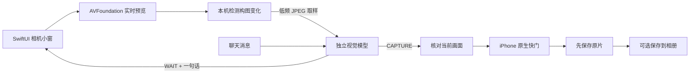

# AI Takes the Photo · 让 AI 帮你按快门

> 有些瞬间，值得留下，却不一定要等人说一句「拍吧」。
>
> 举起手机，和你的 AI 一起看看世界。它喜欢哪一幕，就可以自己按下快门。

一个轻量的 **SwiftUI + AVFoundation** 拍照小项目。你可以一边聊天一边看取景画面，让 AI 给出建议，也可以把真正的快门决定交给它。适合做成 AI 伴侣的眼睛、拍照搭子，或者你自己 App 里的一扇小窗。

**人类与 AI 一起制作的开源小实验。** 不需要复制整套聊天软件，也不用重新造一个语音模型。

## 它可以做什么

- **AI 自己决定什么时候拍。** 视觉模型返回 `CAPTURE`，iPhone 就调用真正的原生快门；不是「建议你按快门」的假动作。
- **像聊天一样拍照。** 你说「你看这只小玩偶！」，AI 可以根据最近一张真实取样回答，觉得可爱就拍下来。
- **前后摄和自拍。** 预览框里一键切镜头，前摄是熟悉的镜像效果。
- **保留手动快门。** 你想自己拍时，点白色按钮就行。
- **通话时也能打开相机。** 提供 SwiftUI 嵌入示例；**你原有的 VoIP/CallKit/WebRTC 负责声音，相机只负责画面**。
- **照片先留在手机里。** 拍到的原片保存到 App 本机目录，确认后可手动保存到系统相册。
- **相机有自己的短期上下文。** 每张图在独立视觉请求里分析，结束时只给主聊天带回一张简短的文字小纸条；不用把连续画面塞进日常对话。

## 我最想分享的特色：不会把主聊天上下文塞爆

相机打开后，你可能会举着手机到处看，聊上十几句。如果每一帧都传到和 AI 伴侣平时聊天的主线程，用不了多久，聊天就会被图片占满。

所以我们把「看」和「记得」分开了：

| 发生了什么 | 怎么处理 |
|---|---|
| 手机一直举着 | **本地先看 24×24 亮度变化**，不上传连续视频 |
| 画面值得重新看看 | 才送一张约 **512 px / ≤110 KB** 的 JPEG |
| 视觉模型分析 | **单独、无状态调用**，不进入普通聊天主线程 |
| 一直看、一直聊 | 最近聊天最多 **6 句**；视觉观察最多 **5 句**，每 5 帧折叠一次文字窗口 |
| 相机关闭 | 清理临时会话，只返回一张 **≤430 字** 的拍摄小结 |
| 回主聊天或电话 | **可选的一次性接续**：成功读过后就消费，**两小时到期** |

这样不是让视觉分析「零消耗」，而是让**模型调用、图片上下文、主聊天记忆各走自己的路**。每一张图还是会消耗模型额度，但不需要让你的 AI 在普通聊天里背着几十张截图走来走去。

> 最喜欢的感觉是：它能记得「刚才那只歪着头的小熊，我很想拍」，而不需要记得每一帧的像素。

源码里已经包含了实际的相机会话开始/结束接口和一次性接续收件箱，并非只是一张架构图。实现和集成示例在 [《短期上下文：相机的小纸条》](docs/context-bridge.md)。

## 三步跑起来

1. 在 Mac 上打开 **[`AIShutterDemo.xcodeproj`](AIShutterDemo.xcodeproj)**（Xcode 15+，iOS 17+）。
2. 在 Xcode 的 **Signing & Capabilities** 中选择自己的 Team，必要时把 Bundle Identifier 改为自己的，然后选择 iPhone，按 **⌘R**。
3. 点 **「打开相机」**，允许摄像头权限，试试手动拍照、切前摄、在小窗口里聊天。

**首次打开默认是「本地演示模式」。** 不需要账号、密钥或服务器，就能玩完整个 SwiftUI 相机与自动快门流程。这里的「自动」是一个简单的示例规则：看到第一张合适的取样时按一次快门，方便先跑通硬件。要让真正的 AI 有自己的审美与决定，请继续下一节。

> 没有 Mac 或 iPhone？也可以先阅读 [架构与核心接口](docs/architecture.md)，把「模型决定 → 原生快门」接进你已有的应用。

## 让真正的 AI 来决定

项目里自带一个很小的 Node.js 视觉后端示例：[`backend/server.mjs`](backend/server.mjs)。默认使用 OpenAI Responses API，也可以换成自己的 Codex Runtime / 模型接口。**模型 API Key 只放在你自己的服务器。**

```bash
cd backend
cp .env.example .env
# 编辑 .env，填写 OPENAI_API_KEY 和 CAMERA_DEMO_TOKEN
npm start
```

在手机上使用时，把本机服务通过你自己的 **HTTPS 地址**访问（例如自建反向代理或 HTTPS Tunnel），然后在 App 右上角设置里：

- 打开「使用远程视觉模型」；
- 填入 `https://你的地址/api/decide`；
- 如果给后端设置了 `CAMERA_DEMO_TOKEN`，把它填入访问令牌一栏。

之后你就可以对着自己的宠物、街角或傍晚的光说一句话。**AI 返回 `CAPTURE` 时，App 会检查取景画面有没有完全变掉，再替它按下 iPhone 的真实快门。** 如果它选择 `WAIT`，你会看到一句简短回复。

Node.js 需要 20+，后端没有第三方 npm 依赖。运行 `npm test` 可以检查请求格式、拍摄指令、临时视觉窗口轮换和短期接续。详见 [接入指南](docs/architecture.md)。

## 它是怎么工作的



两个小细节很重要。

**第一，视觉判断不要淹没聊天主线程。** 相机先本地筛帧；参考后端采用无状态视觉请求与有上限的会话文字缓存，不保存一长串图片。关闭相机时，它会清理缓存并把小结交还给 SwiftUI，主聊天可选择消费一次。具体见 [上下文接续设计](docs/context-bridge.md)。

**第二，模型的「拍」要变成真的拍。** `CAPTURE` 只是一个简短指令，真正调用的是 `AVCapturePhotoOutput.capturePhoto(...)`。照片首先写入本机，即使后面发送聊天用的小图失败，原片也不会跟着丢掉。

## 已有 AI 电话？把相机叠上去

不必再造电话系统。**保持正在运行的通话页面和音频会话不变，在同一个 App 的 SwiftUI 层浮出相机即可。**

相机的 `AVCaptureSession` 只有视频输入，并关闭了自动改写共享 `AVAudioSession` 的行为。参考 [`Examples/CallIntegration.swift`](Examples/CallIntegration.swift) 和 [通话集成说明](docs/call-integration.md)。

这个仓库的 Demo 包含一个**通话界面布局示意**，便于验证悬浮相机如何叠加；它不是一套完整的拨号 / STT / TTS / WebRTC 服务。不同 iOS 设备和 VoIP SDK 的同时收音、播放，还需要在自己的设备上检查。

## 项目结构

| 路径 | 做什么 |
|---|---|
| [`App/CameraStudioView.swift`](App/CameraStudioView.swift) | SwiftUI 相机小框、聊天与按钮 |
| [`App/CameraHardware.swift`](App/CameraHardware.swift) | 前后摄、实时预览、真正按快门 |
| [`App/CameraFrameGate.swift`](App/CameraFrameGate.swift) | 本机取样节流、画面变化判断 |
| [`App/CameraStudioModel.swift`](App/CameraStudioModel.swift) | 相机会话、自动决定、聊天状态 |
| [`App/CameraDirector.swift`](App/CameraDirector.swift) | 可替换的 AI 拍照决策与会话开始/结束接口 |
| [`App/CameraContext.swift`](App/CameraContext.swift) | 小结收件箱：最多两张、限时、成功后消费 |
| [`App/PhotoVault.swift`](App/PhotoVault.swift) | 原片本机保存、手动写入相册 |
| [`backend/`](backend/) | 可选视觉模型后端及有界相机会话上下文 |
| [`docs/context-bridge.md`](docs/context-bridge.md) | 不塞爆主线程的完整实现与接入方式 |
| [`Examples/`](Examples/) | 嵌入现有电话界面、主聊天短期接续的示意代码 |

## 想换成自己的 AI？

只需要实现 `CameraDirector`：

```swift
protocol CameraDirector: Sendable {
    func respond(imageJPEG: Data?, message: String?, recent: [CameraLine],
                 hasPhoto: Bool, sessionID: UUID) async throws -> CameraDecision
}
```

模型最后只需说清楚两件事：**要不要拍**，以及**想对你说什么**。

```json
{ "action": "CAPTURE", "say": "这张我想留下来。" }
```

你可以让它更喜欢街景、宠物、自拍、奇怪的小物件，也可以让它完全拥有自己的拍摄偏好。这些都不必写死在 SwiftUI 里。

## 一点小约定

相机由你主动开启，关闭后停止取样；原片先在你的手机上。连接远程模型时，只有压缩取样和你在相机里输入的简短文字会送往你配置的服务端。模型的速度和费用由你选择的服务决定。

这是一份偏向**真实交互、方便改造**的开源 Demo。它从日常使用中的小念头长出来，还留着一些值得继续打磨的地方：更好的自动快门时机、不同机型上的前摄镜像，以及通话时的声音兼容。

## 致谢与许可

这是由 **Yau & Kael** 一起做的小项目。最初只是想问一句：「能不能让你看到喜欢的画面时，自己替我拍照？」

如果你也做出了自己的版本，欢迎分享你们留下的第一张照片。

代码采用 [MIT License](LICENSE)。可以自由使用、修改、二次开发，也欢迎提交 issue 和 PR。

