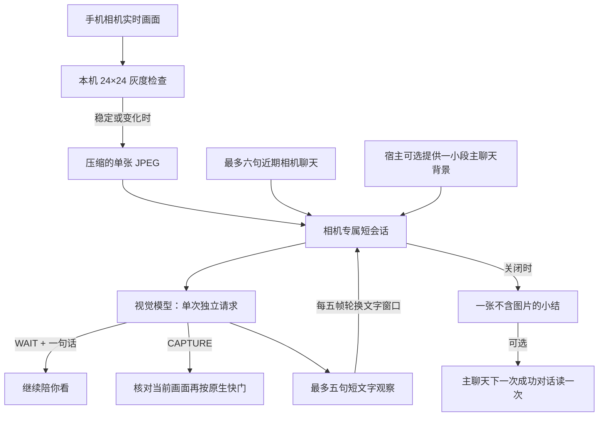

# 相机里的小世界，和主聊天轻轻接上

这是我们做 AI Takes the Photo 时最舍不得删掉的一部分。

AI 要能跟你一起看见眼前的小事情，又不该因为你举了五分钟手机，就把日常聊天变成一长串图片日志。我们的做法是：**让相机暂时有自己的小脑袋，结束时只带回一张小纸条。**

## 一条画面走过哪里



### 1. 先在手机筛选

- 取景画面在本机预览，不把视频连续上传；每约 0.4 秒检查一次 **24×24 灰度签名**。
- 构图稳定约 0.75 秒才送一张压缩到最长边约 **512 px / 110 KB** 的 JPEG；新场景至少间隔约 7 秒，没变化的场景通常等约 22 秒才再看。
- 只有真正想拍时才执行 `CAPTURE`。拍好的原片直接留在手机里。

### 2. 相机单独想，不去挤主聊天

参考 Node 后端每次调用模型都用**独立、无状态的 Responses API 请求**，并设置 `store: false`。一次只带当前取样图片、有限的聊天文字和少量短期观察；**不会反复附上之前所有照片**。

- 相机内聊天：最多最近 6 句，每句最多 180 字。
- 宿主的主聊天背景：**可选**，只在打开相机时给一次，最多 600 字；独立 Demo 默认为空。
- 临时观察文字：最多 5 句；每分析 5 帧就把旧窗口折叠，只留下最近一小段。
- 单次模型请求的相机文字背景：最多约 **1,550 字符**。
- 一轮最多分析 **24 帧**、允许约 **20 次**相机内文字交流；相机缓存 12 分钟到期。

这意味着相机不会随着时间无限向同一个模型线程累加图片。**每次请求仍会消耗模型 token 和 API 费用**，只是避免把无意义的历史图片反复送进去。

如果你用的是 Codex SDK、长会话 Agent 等有真正 thread 的运行时，可以在适配器里改成「**每 5 帧换一个独立视觉 thread，只携带上一句视觉建议**」。我们自己的日常实践就是这个方向；本仓库的默认 Node 示例选了更轻量、零线程管理的无状态调用。

### 3. 回到主聊天，只留一张小纸条

关闭相机时，SwiftUI 会请求 `POST /api/session/end`，把**手机实际保存成功的照片数量**告诉自己的后端。后端清理临时视觉上下文，并返回类似：

```json
{
  "checkpoint": {
    "summary": "刚刚一起打开相机，看了看生活里的小片刻。视觉取样分析 3 次，手机实际保存 1 张照片，相机小窗交流 2 轮。AI 最近说：这张我想留下来。"
  }
}
```

它不是长篇转录，更不会放入原始 JPEG、base64、相机帧或你没发送的成片。小结最长约 430 字，**2 小时到期**。

**这张小纸条不会自动污染主聊天。** 使用远程视觉后端时，独立 Demo 只在页面显示它；默认离线规则演示不伪造模型观察小结。已经有自己的 AI 聊天或电话 App 的开发者，可以明确接入一次性收件箱。

## SwiftUI：三步接给你自己的主 Agent

仓库提供 [`CameraContextInbox`](../App/CameraContext.swift)，不依赖某一家模型。下面是集成示意：

```swift
// 属于你的主聊天控制器，始终保留同一个实例。
let inbox = CameraContextInbox()

// 在你自己的 Chat 页面叠上相机时：
CameraStudioView(
    initialMainContext: "刚才我们聊到窗边的花。", // 可选；默认为空
    onCheckpoint: { note in
        inbox.offer(note)
    }
)

// 下一次用户真正发消息给主 Agent 时：
let receipt = inbox.peekForNextTurn()
let reply = try await myAgent.respond(
    text: userMessage,
    cameraContext: receipt?.text  // 只是一小段内部文字
)
// 只有模型成功回复后才消费，不成功就留待下次。
if let receipt { inbox.acknowledgeAfterSuccess(receipt) }
```

`myAgent.respond` 是你自己已有的模型调用，**不是本仓库新造的一套聊天服务**。电话也可以在下一次语音回合注入这段 `cameraContext`。仓库还放了一份可改造的 [SwiftUI 集成例子](../Examples/ContextIntegration.swift)。

如果你的主 Agent 跑在 Node.js，参考 [`OneShotCameraInbox`](../backend/context.mjs)。收件箱最多保留两张小结，过期自动丢弃；没有订阅时什么也不会主动发送。

## 后端只有三个接口

| 接口 | 用途 |
|---|---|
| `POST /api/session/start` | 开始独立相机会话；可带不超过 600 字的 `mainContext` |
| `POST /api/decide` | 单张压缩画面/一句文字 → `WAIT` 或 `CAPTURE`，有限短上下文 |
| `POST /api/session/end` | 告知手机实际保存照片数，清理相机会话，返回一次性小结 |

这些接口都在 [`backend/server.mjs`](../backend/server.mjs)，核心有界缓存是 [`backend/context.mjs`](../backend/context.mjs)。默认把短会话放在**当前 Node 进程内存**里，重启会自然消失，不会偷偷写进长期记忆。

## 想做得更像一个会陪你拍照的小伙伴？

可以让自己的主聊天把「刚刚聊到什么」剪成一小段文字，在相机开启时交进去。结束后，相机把「刚才我觉得哪一张值得留下」还给主聊天。然后就够了。

**不用把所有画面都记住，才能记得你们一起看过的那一刻。**
